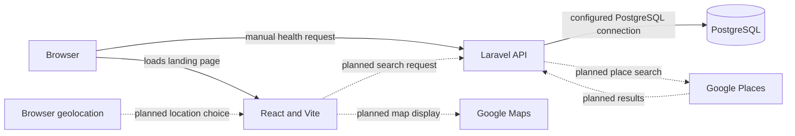

# KainFinder

## Project overview

KainFinder aims to help people discover food around a chosen point in Metro Manila. The **planned MVP** is: use browser location or choose a map point, submit a nearby search, and show matching places as map pins. Today this repository is a development scaffold: a responsive landing page, one Laravel health endpoint, and a local PostgreSQL service. There is no search, map, geolocation request, Google integration, restaurant data, or authentication yet.

The proposed interface direction is in [docs/design.md](docs/design.md).

## Architecture

Solid arrows show implemented or configured paths; dotted arrows are **planned**. The database connection is configured in Compose and Laravel, but the health route does not query it and container runtime has not been verified.



**Planned search flow:** the browser supplies a location or manually selected point; React sends a search request to Laravel; Laravel requests limited place data from Google Places and returns results for map pins. PostgreSQL access stays behind Laravel so database credentials and queries are never exposed to browser code. No search data flow is implemented today.

## Repository structure

```text
.
├── compose.yaml                 # local frontend, API, PostgreSQL
├── .env.example                 # Compose PostgreSQL variables
├── .gitignore
├── README.md
├── frontend/
│   ├── Dockerfile
│   ├── index.html
│   ├── package.json
│   ├── package-lock.json
│   ├── vite.config.ts
│   └── src/
│       ├── App.tsx              # landing page
│       └── index.css            # Tailwind import
└── backend/
    ├── Dockerfile
    ├── .env.example
    ├── composer.json
    ├── composer.lock
    ├── phpunit.xml
    ├── bootstrap/app.php        # API route registration
    ├── config/cors.php
    ├── config/database.php
    ├── routes/api.php
    ├── tests/Feature/HealthTest.php
    └── database/migrations/     # Laravel default tables; no restaurant table
```

## Prerequisites and quick start

Use Docker Desktop with its **Linux engine running** and Docker Compose. The containers use Node.js 24, PHP 8.4, and PostgreSQL 18.6. Ports `5173`, `8000`, and `5432` must be available. From the repository root in PowerShell:

```powershell
Copy-Item .env.example .env
Copy-Item backend/.env.example backend/.env
# Replace the example PostgreSQL password in .env before starting.
docker compose build
docker compose run --rm api php artisan key:generate
docker compose up -d
docker compose exec api php artisan migrate
```

Open <http://localhost:5173> for the landing page and <http://localhost:8000/api/health> for the API response. Stop services with `docker compose down`. Docker startup and these URLs still need a live container check in this environment.

## Environment variables

The copied files are local and Git-ignored. Values in the examples are development placeholders, not production credentials. Compose passes root PostgreSQL values into Laravel, overriding `backend/.env` `DB_*` values; the latter are useful if running PHP outside Docker.

| Variable | Owner | Purpose | Status |
| --- | --- | --- | --- |
| `POSTGRES_DB`, `POSTGRES_USER`, `POSTGRES_PASSWORD` | Root `.env` → Compose database and API | Local database name and credentials | Required now for Docker |
| `APP_NAME`, `APP_ENV`, `APP_DEBUG`, `APP_URL` | Laravel `backend/.env` | App identity, mode, debug, URL | Used now; set production values when deployed |
| `APP_KEY` | Laravel `backend/.env` | Laravel encryption key; generated by Artisan | Required now |
| `DB_CONNECTION`, `DB_HOST`, `DB_PORT`, `DB_DATABASE`, `DB_USERNAME`, `DB_PASSWORD` | Laravel; Compose overrides for containers | PostgreSQL connection | Required now for database operations |
| `FRONTEND_URL` | Laravel `backend/.env` | Allowed CORS origin; defaults to `http://localhost:5173` | Used now |
| `LOG_CHANNEL`, `LOG_LEVEL`, `SESSION_DRIVER`, `CACHE_STORE`, `QUEUE_CONNECTION`, `MAIL_MAILER` | Laravel `backend/.env` | Local framework behavior | Configured now |
| Browser Maps key; server Places key | **Planned**, not defined in this repository | Separate restricted Google credentials | Required only for planned integration |

Never put the database password or a future server Places key in a Vite browser variable.

## Development checks

Run from the repository root after the quick start. `npm ci` requires Node.js and npm on the host; the Laravel and database commands use the API container.

```powershell
npm --prefix frontend ci
npm --prefix frontend run lint
npm --prefix frontend run build
docker compose config
docker compose exec api php artisan test
docker compose exec api php artisan db:show --database=pgsql
```

The last command is the **pending PostgreSQL connection check**; migrations also remain pending in a running container. In the earlier scaffold verification, the frontend lint/build passed, three Laravel tests passed with local PHP and in-memory SQLite, and `docker compose config` passed after example environment files were copied. Those tests do not prove a live PostgreSQL connection. Docker Desktop's Linux engine was unavailable, so image builds, container startup, host URLs, API tests inside Docker, migrations, and the database connection remain unverified. This README edit has not changed application code.

## API

| Route | Current behavior |
| --- | --- |
| `GET /api/health` | HTTP 200, JSON `{"success":true}`; no database query |

The health test also checks that a preflight request from `http://localhost:5173` receives the configured CORS header.

### Planned API

A nearby search route accepting a location or chosen point and returning place summaries is **planned**. Its path and response contract have not been set or implemented.

## Google integration and cost controls (planned)

Use a browser key restricted to the site's HTTP referrers and Maps JavaScript API, plus a separate server key kept only in Laravel and restricted to the needed Places API. Choose supported application restrictions for the backend deployment. Request Places data only when a user submits a search, use a narrow [field mask](https://developers.google.com/maps/documentation/places/web-service/usage-and-billing), and set quotas plus billing alerts. Display Google and third-party [attribution](https://developers.google.com/maps/documentation/places/web-service/policies) as required. Google documents [key restrictions](https://developers.google.com/maps/api-security-best-practices), [usage and billing](https://developers.google.com/maps/documentation/javascript/usage-and-billing), and [cost controls](https://developers.google.com/maps/billing-and-pricing/manage-costs). These sources were checked **2026-11-02**; no price or quota is assumed here.

## Privacy and data handling

**Intended MVP policy:** ask for location only when the user chooses it; also offer a manually chosen point. Send only the coordinates needed for a submitted search, avoid storing precise user location, and do not persist restaurant records. Treat Google Places content as request-time display data, subject to Google's [storage and attribution rules](https://developers.google.com/maps/documentation/places/web-service/policies); do not build a permanent Places cache. **Current code:** it does not request, send, or store user location or Places content. The database has Laravel's default migrations, not a restaurant table.

## Deployment plan (planned)

Deploy the static frontend to Vercel, the Laravel Docker image to Render, and PostgreSQL to Supabase. This is **planned**, not deployed or tested. Before deployment, use HTTPS, set the production frontend origin in `FRONTEND_URL`, provide server environment secrets, run Laravel migrations against Supabase PostgreSQL, and verify the health and database checks. Budget for free-tier constraints: Render free web services may sleep and have ephemeral filesystems; Supabase free projects may pause with low activity; Vercel Hobby has usage limits. Check the current [Render](https://render.com/docs/free), [Supabase](https://supabase.com/docs/guides/platform/free-project-pausing), and [Vercel](https://vercel.com/docs/limits) documentation before choosing a plan (checked **2026-11-02**).

## Troubleshooting and known gaps

- If Compose reports `failed to connect to the docker API at npipe:////./pipe/dockerDesktopLinuxEngine`, start Docker Desktop and wait for its Linux engine. This prevented the runtime checks listed above.
- If Compose reports a missing `backend/.env`, copy both example files as shown in quick start. If ports are occupied, free `5173`, `8000`, or `5432` before starting.
- A healthy `/api/health` response confirms routing only; use the database check above to verify PostgreSQL separately.
- Search, map pins, geolocation, Google keys, restaurant persistence, and cloud deployment are not implemented.

## Next milestone

**Planned:** location or manual map point → Laravel search → map pins.
